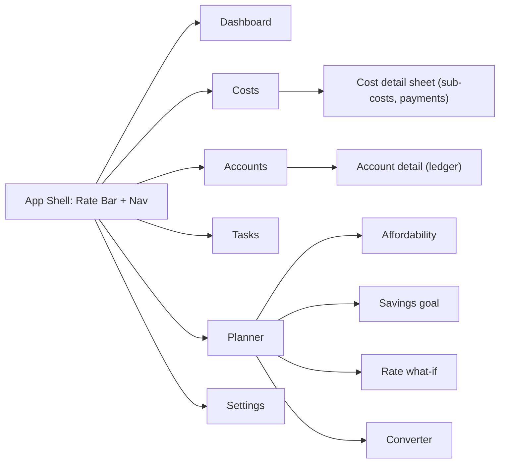

# RubenYaro — USMLE Journey Cost & Task Planner
**Design Specification v1.0** · Target: static SPA on GitHub Pages · Implementer: Gemini (see `HANDOFF.md`)

> Purpose: give one clear picture of **how much money I have, where it is, what the USMLE journey will cost, what's paid, what's left, and what work is pending.**

---

## 0. Table of contents
1. Product principles
2. Tech stack & hosting
3. Information architecture (screens)
4. Data model (TypeScript)
5. Currency engine (formulas — source of truth)
6. Screen-by-screen spec
7. Design system (visual)
8. Interactions, empty states, a11y
9. Persistence, backup, privacy
10. Folder structure
11. Testing & definition of done

---

## 1. Product principles
| Principle | Meaning in practice |
|---|---|
| **Clarity over features** | Every screen answers one question. Dashboard answers "Am I funded?" |
| **Everything editable** | Every seeded value, rate, category, phase is editable in-app. Nothing hard-coded except defaults. |
| **Two currencies, always** | Any amount can be entered in USD *or* PKR; the other is shown live beside it. |
| **Local-first & private** | Data lives in the browser (localStorage). The GitHub repo contains **zero personal data**. |
| **Fast entry** | Add a cost / task / transaction in ≤ 3 interactions (⌘K or `+` button → sheet → Save). |
| **Calm UI** | Neutral surfaces, one accent colour, semantic colours only for status (funded / short / estimate). |

---

## 2. Tech stack & hosting
| Concern | Choice | Why |
|---|---|---|
| Build | **Vite + React 18 + TypeScript (strict)** | Fast, static output, Pages-friendly |
| Styling | **Tailwind CSS v4** + CSS variables for tokens | Quick modern styling, dark mode via `class` |
| State | **Zustand** + `persist` middleware (localStorage) | Tiny, simple, persistent |
| Routing | **React Router — `HashRouter`** | No 404 issues on GitHub Pages |
| Icons | `lucide-react` | Clean minimal line icons |
| Charts | `recharts` | Donut, bar, area charts |
| Drag & drop | `@dnd-kit/core` + `@dnd-kit/sortable` | Reorder costs / tasks / kanban |
| Dates | `date-fns` | Countdowns, recurrence |
| IDs | `nanoid` | Stable IDs |
| Command palette | `cmdk` | ⌘K quick actions |
| Tests | `vitest` | Currency + selectors unit tests |
| PWA (CP10) | `vite-plugin-pwa` | Installable, offline |
| Deploy | **GitHub Actions → GitHub Pages** (`actions/deploy-pages`) | Push to `main` = live |

`vite.config.ts` must set `base: '/<repo-name>/'` (read from env `VITE_BASE` with fallback `'/'`).

No backend. No API keys. Only network call = exchange-rate fetch (with manual fallback).

---

## 3. Information architecture


| Route | Screen | Answers |
|---|---|---|
| `#/` | Dashboard | Am I funded? What's due next? What's pending? |
| `#/costs` | Costs | What does the whole journey cost, by phase/category? |
| `#/accounts` | Accounts | Where is my money and how has it moved? |
| `#/tasks` | Tasks | What USMLE work is left? |
| `#/planner` | Planner | What if…? How much must I save per month? |
| `#/settings` | Settings | Rates, tax, categories, phases, data |

**Navigation**: desktop ≥1024px = left sidebar (icons + labels, collapsible to icons). Mobile = bottom tab bar (Dashboard, Costs, `+`, Tasks, More). The centre `+` opens a quick-add menu (Cost / Payment / Transaction / Task).

**Global Rate Bar** (sticky, top of every screen) — see §6.0.

---

## 4. Data model (TypeScript — source of truth)
```ts
export type Currency = 'USD' | 'PKR';
export type ConversionMode = 'market' | 'effective' | 'detailed';
//  market    = USD × live/manual market rate
//  effective = USD × flat "after-tax card rate" (default 300)
//  detailed  = USD × market rate + tax (% or fixed PKR)

export interface Money { amount: number; currency: Currency }   // stored as entered, never pre-converted

export interface TaxRule { kind: 'percent' | 'fixed'; value: number } // fixed is in PKR

export interface Settings {
  schemaVersion: number;                 // start at 1; bump + migrate on change
  displayCurrency: Currency;             // primary currency in UI
  rates: {
    market: number;                      // PKR per 1 USD
    marketSource: 'auto' | 'manual';
    marketUpdatedAt: string | null;      // ISO
    marketProvider: string | null;       // e.g. 'open.er-api.com'
    effective: number;                   // default 300
  };
  defaultConversionMode: ConversionMode; // default 'effective'
  defaultTax: TaxRule;                   // default { kind:'percent', value: 0 } – user fills
  theme: 'system' | 'light' | 'dark';
  privacyMode: boolean;                  // blur all amounts
  journey: { targetDate: string | null; examDates: KeyDate[] };
  categories: Category[];
  phases: Phase[];
}

export interface Category { id: string; name: string; color: string; icon: string } // icon = lucide name
export interface Phase    { id: string; name: string; order: number; color: string }  // Step 1, Step 2 CK, ...

export interface Account {
  id: string; name: string;
  kind: 'bank' | 'cash' | 'card' | 'wallet' | 'foreign' | 'other';
  currency: Currency;
  openingBalance: number;                // in account currency
  color: string; icon: string; note?: string;
  includeInTotals: boolean;              // e.g. exclude an emergency fund
  reserved?: number;                     // amount earmarked "do not touch" (account currency)
  archived: boolean; order: number; createdAt: string;
}

export type TxnType = 'deposit' | 'withdrawal' | 'transfer' | 'payment';
export interface Transaction {
  id: string; type: TxnType; date: string;  // ISO date
  accountId: string;                         // source (or target for deposit)
  toAccountId?: string;                      // transfer only
  amount: number;                            // in source account currency
  toAmount?: number;                         // transfer across currencies (user-entered or auto at market)
  costId?: string; subCostId?: string;       // payment only
  note?: string; createdAt: string;
}

export type CostKind = 'fixed' | 'estimate';
export type Priority = 'must' | 'should' | 'nice';

export interface Recurrence {               // e.g. Qbank monthly subscription
  frequency: 'weekly' | 'monthly' | 'yearly';
  interval: number;                          // every N
  occurrences: number;                       // total count
  startDate: string;
}

export interface CostItemBase {
  id: string; name: string;
  money: Money;                              // per-occurrence amount
  range?: { low: number; high: number };     // optional, same currency as money (estimates)
  kind: CostKind;
  conversionMode?: ConversionMode;           // overrides settings.defaultConversionMode
  tax?: TaxRule;                             // overrides settings.defaultTax (detailed mode only)
  note?: string; url?: string;
}

export interface SubCost extends CostItemBase { order: number; included: boolean; maybe: boolean }

// Alternative ways to pay for the same thing, only ONE active (e.g. Flights: "Round trip" vs "Separate one-ways")
export interface CostVariant {
  id: string; name: string;
  money: Money; range?: { low: number; high: number };
  subCosts: SubCost[];                         // same Σ rule as Cost
  note?: string;
}

export interface Cost extends CostItemBase {
  categoryId: string; phaseId: string; priority: Priority;
  dueDate?: string;
  temporary?: { start: string; end: string };  // only counts in plan inside window; auto-flag "expired"
  recurrence?: Recurrence;
  subCosts: SubCost[];                         // if non-empty → parent total = Σ included sub-costs
  variants?: CostVariant[];                    // if present → cost total = active variant total (money/subCosts on Cost ignored)
  activeVariantId?: string;
  maybe: boolean;                              // uncertain cost ("maybe"): counted separately (see selectors)
  included: boolean;                           // toggle in/out of plan (what-if)
  archived: boolean; order: number; tags: string[];
  verify?: boolean;                            // seeded placeholder: show "verify price" chip
  createdAt: string; updatedAt: string;
}

export type TaskStatus = 'todo' | 'doing' | 'done';
export interface Task {
  id: string; title: string; note?: string;
  phaseId?: string; status: TaskStatus; priority: Priority;
  dueDate?: string; tags: string[];
  checklist: { id: string; text: string; done: boolean }[];
  linkedCostId?: string;                    // e.g. "Pay Step 1 fee" ↔ cost
  progress?: { current: number; total: number; unit: string }; // e.g. 1200/3600 questions
  order: number; createdAt: string; completedAt?: string;
}

export interface KeyDate { id: string; label: string; date: string; kind: 'exam' | 'deadline' | 'eligibility' | 'other' }

export interface AppData {
  settings: Settings; accounts: Account[]; transactions: Transaction[];
  costs: Cost[]; tasks: Task[];
}
```

### Derived values (selectors, never stored)
| Selector | Rule |
|---|---|
| `costSource(cost)` | `variants?.length ? activeVariant : cost` (the thing whose money/subCosts are used) |
| `costOccurrenceTotal(cost)` | `src = costSource(cost)`; `src.subCosts.length ? Σ(included && !maybe subCosts → PKR) : src.money → PKR` |
| `costMaybeExtra(cost)` | Σ of included sub-costs with `maybe:true` (e.g. Job payment "+ maybe 36k") |
| `costTotal(cost)` | occurrence total × (`recurrence?.occurrences ?? 1`) |
| `costPaid(cost)` | Σ payment transactions with `costId` (converted to PKR at **effective** rate if account is USD… see §5.4) |
| `costStatus(cost)` | `paid ≥ total` → **Paid**; `paid > 0` → **Partial**; due ≤ 14 days → **Due soon**; past due → **Overdue**; else **Planned** |
| `accountBalance(acc)` | opening + deposits − withdrawals − payments ± transfers |
| `totalFunds` | Σ balances of accounts with `includeInTotals && !archived`, minus `reserved` |
| `planTotal` (confirmed) | Σ `costTotal` for `included && !archived && !expired && !maybe` |
| `maybeTotal` | Σ `costTotal` of `maybe` costs + Σ `costMaybeExtra` of all costs (same filters) |
| `planWithMaybes` | `planTotal + maybeTotal` — dashboard shows gap for **both** |
| `remaining` | `planTotal − Σ costPaid` |
| `coverage` | `totalFunds / remaining` (cap display at 100%+) |
| `gap` | `totalFunds − remaining` (positive = surplus, negative = shortfall) |
| `range` | Σ low / Σ high for estimates (fixed costs count same in both) |

**Canonical comparison currency = PKR.** All funding maths happens in PKR (because the money is mostly held in PKR and PKR is what you actually lose). USD views are a display conversion.

---

## 5. Currency engine (`src/lib/currency.ts`) — exact formulas
Let `M` = market rate (PKR per USD), `E` = effective rate (default **300**), tax rule `t`.

### 5.1 USD → PKR
| Mode | Formula |
|---|---|
| `market` | `pkr = usd × M` |
| `effective` | `pkr = usd × E` |
| `detailed` | `base = usd × M`; `tax = t.kind==='percent' ? base × t.value/100 : t.value`; `pkr = base + tax` |

### 5.2 PKR → USD (inverse, used when an amount is entered in PKR)
| Mode | Formula |
|---|---|
| `market` | `usd = pkr / M` |
| `effective` | `usd = pkr / E` |
| `detailed` | percent: `usd = pkr / (M × (1 + p/100))`; fixed: `usd = max(0, pkr − f) / M` |

### 5.3 Breakdown object (shown in tooltips & cost detail)
```ts
interface Breakdown { usd: number; marketPkr: number; tax: number; totalPkr: number; mode: ConversionMode; rateUsed: number }
```
UI line example: **$1,000 → ₨281,400 + tax ₨14,070 (5%) = ₨295,470**

### 5.4 Account money
- PKR accounts: native.
- USD accounts (e.g. a foreign account / USD card): value in PKR = `usd × M` (holding real dollars → no card tax).
- **Spending power (USD)** card on dashboard = `USD accounts + PKR accounts / E` → "how many dollars can I actually pay with".
- A payment from a USD account to a USD cost reduces the cost by its USD amount at the cost's own mode (fully clears it, no tax). Implement: if account currency === cost currency, payment counts against the cost **in native currency** (paid ratio = paid / native amount), then converted for display.

### 5.5 Formatting
- USD: `$1,234.56` (2 dp). PKR: `₨ 1,234,567` (0 dp) with option in Settings for lakh grouping `₨ 12,34,567` (`en-PK` vs `en-IN` style). Use `Intl.NumberFormat`. Always `font-variant-numeric: tabular-nums`.
- Compact form for cards: `₨ 1.2M`, `$4.3k`.
- Store raw numbers; round only at display.

### 5.6 Live market rate
1. Primary: `GET https://open.er-api.com/v6/latest/USD` → `rates.PKR` (free, no key, CORS-enabled, daily update).
2. Fallback: `GET https://cdn.jsdelivr.net/npm/@fawazahmed0/currency-api@latest/v1/currencies/usd.json` → `usd.pkr`.
3. Cache result + timestamp in settings; auto-refresh if older than **12 h** and `marketSource === 'auto'`.
4. If both fail → keep last value, show amber "offline · last updated 3d ago" chip.
5. **Manual override**: user types a rate (e.g. open-market rate from their bank) → `marketSource='manual'`, auto-refresh paused, chip shows "Manual". One click "Use live rate" returns to auto.

> Note in UI (Settings helper text): "Interbank rates can differ from open-market/bank card rates. Use Manual for your bank's actual rate."

---

## 6. Screen-by-screen spec

### 6.0 Global Rate Bar (sticky, 44px, every screen)
```
[● Live] 1 USD = ₨ 281.40 · 2h ago ⟳   |   Card rate ₨ 300   |   Tax 5%   |   [USD ⇄ PKR]  [👁 privacy]  [⌘K]
```
- Click any chip → popover with inline editable number input (Enter saves).
- `USD ⇄ PKR` segmented toggle switches `displayCurrency` app-wide (animate number change with a 150ms fade).
- 👁 toggles `privacyMode` (blur `filter: blur(6px)` on every `<Amount>`; hover/long-press reveals one).
- Mobile: collapses to `₨281.4 · ₨300` + toggle; tap opens a bottom sheet with all controls.

### 6.1 Dashboard (`#/`)
Grid: 12 cols desktop, 1 col mobile. Order top → bottom:

1. **Hero "Funding status" card** (span 8)
   - Big number: **Gap** — green "₨ 420,000 surplus" or rose "₨ 380,000 short".
   - Horizontal stacked bar: `Paid | Funded remaining | Unfunded` against plan total.
   - Sub-line: "Plan ₨ 2.4M · Paid ₨ 0.6M · Funds ₨ 1.4M · Coverage 78%".
   - Second line, muted: "**With maybes** (+₨ 456k): ₨ 2.5k short" — a toggle `Include maybes` switches the hero big number between the two scenarios.
   - If estimates have ranges: thin range marker "₨ 2.2M – 2.7M".
2. **Spending power card** (span 4): `$ 4,650` you can spend via card at ₨300; plus "Real USD held $500".
3. **KPI row** (4 small cards): Total funds · Plan total · Paid · Remaining. Each shows the secondary currency in muted small text below.
4. **Upcoming payments** (span 6): next 5 costs by `dueDate`, chip status (Due soon / Overdue), quick action "Mark paid" → opens payment sheet prefilled.
5. **Cost by phase** (span 6): horizontal bars per phase (Step 1, Step 2 CK, ECFMG/OET, Match…) paid vs remaining.
6. **Cost by category** donut (span 4) with legend.
7. **Accounts strip** (span 8): horizontally scrollable mini-cards (name, balance, currency flag).
8. **Tasks snapshot** (span 6): pending count, 3 next tasks, overall progress ring (done/total).
9. **Countdowns** (span 6): Key dates as pills "Step 1 in 74 days", eligibility window end, etc.

### 6.2 Costs (`#/costs`)
- **Header**: title, total for current filter (both currencies), `+ Add cost`.
- **Toolbar**: search · view switch **[By phase | By category | Timeline | Table]** · filters (status, kind fixed/estimate, priority, include temporary, show archived) · sort.
- **Cost row (collapsed)**:
  `⠿ [icon] Step 1 Exam Fee  [Fixed] [Must]  · due 12 Feb      $1,000   ₨300,000   ▓▓▓░ 60%   ⋯`
  - Left drag handle (reorder). Category colour dot. Chips: `Fixed`(neutral) / `Estimate`(amber dashed border), `Temporary` (clock icon, shows window), `Recurring ×6`, `Verify price` (seeded placeholders).
  - Right: primary amount in display currency, secondary muted; mini progress bar of paid %.
  - Toggle switch (subtle) for `included` — excluded rows render at 50% opacity with strikethrough total.
  - **Maybe** chip (`?` icon, dotted outline, muted violet) for `maybe` costs/sub-costs; their amount shows prefixed `+` and in muted colour. Clicking the chip converts Maybe ⇄ Confirmed.
  - **Variants** (cost has `variants`): a small segmented control under the name, e.g. `[Round trip ₨600k] [Separate ₨560k]`; tapping switches `activeVariantId` and totals animate. Cheapest variant gets a tiny "lowest" tag. Expanding shows the active variant's sub-costs (e.g. Outbound / Return).
- **Expanded row (has sub-costs)**: chevron expands an indented list with a left guide line; each sub-cost shows amount, its own include toggle, and a mini proportional bar (share of parent). Inline "+ Add sub-cost" at the bottom. Parent amount becomes read-only "Σ of sub-costs" with an info tooltip.
- **Timeline view**: vertical timeline grouped by month of `dueDate`; recurring costs show each occurrence; temporary costs show as a band spanning start→end.
- **Table view**: dense spreadsheet-like (name, phase, category, kind, USD, PKR, paid, status, due) — inline editable cells, CSV export.

**Cost detail sheet** (right side drawer 480px desktop / full-height bottom sheet mobile), tabs:
1. **Details** — Name; **MoneyInput** (see §7.4); kind (Fixed/Estimate segmented) + optional low/high range; category; phase; priority; due date; temporary toggle → start/end; recurring toggle → frequency/interval/occurrences; conversion mode override (Default / Market / Card 300 / Detailed + tax override); URL; notes; tags.
2. **Sub-costs & options** — sortable list, inline edit (each row: name, MoneyInput, include toggle, Maybe toggle), totals footer "₨ 57k + maybe ₨ 36k", mini donut of composition. "+ Add option" turns the cost into variants; options shown as side-by-side compare cards with "Use this" button.
3. **Payments** — list of linked transactions + "Record payment" (choose account, amount auto-filled with remaining, date). Status auto-updates.
4. **Breakdown** — the §5.3 breakdown for all three modes side-by-side so the user sees market vs card vs detailed difference.

### 6.3 Accounts (`#/accounts`)
- Top summary: Total funds (PKR & USD), Reserved, Available.
- Cards grid (drag to reorder): name, kind icon, currency, big balance, secondary currency, "Reserved ₨50k" chip, sparkline of balance over time (from ledger).
- Actions per card: Deposit · Withdraw · Transfer · Edit · Archive.
- **Account detail**: ledger table (date, type icon, note, linked cost, amount ±, running balance), filters by type/date.
- **Transfer sheet**: from → to; if currencies differ, show both amounts with the implied rate (editable, prefilled at market).

### 6.4 Tasks (`#/tasks`)
- Header: overall progress ring + "18 of 42 done", `+ Add task` (also inline quick-add input at top: type and press Enter; supports quick syntax `Book Step 1 date #step1 !must @2026-12-10`).
- View switch: **[List by phase | Board | Upcoming]**
  - *List*: collapsible phase groups with per-phase progress bar; rows = round checkbox, title, due chip, priority dot, checklist count `2/5`, progress bar if `progress` set, linked-cost chip (`₨ 300k` → opens cost).
  - *Board*: kanban columns To do / Doing / Done (dnd-kit).
  - *Upcoming*: Overdue · Today · This week · Later · No date.
- Completing a task: checkbox fills with accent, row slides & fades to the "Completed" collapsible section; toast with **Undo**.
- If a task with `linkedCostId` is completed and the cost is unpaid → toast suggests "Record payment for Step 1 fee?".
- **Progress trackers** (task with `progress`): `+10 / +40` quick increment buttons (e.g. Qbank questions, NBME forms, Anki reviews).
- Seeded task templates (Settings → "Load USMLE starter checklist"): see `docs/seed.json`.

### 6.5 Planner (`#/planner`) — helpful tools
1. **Affordability check**: pick a cost (or type an amount) → "After paying this you'll have ₨ X left; plan coverage drops to Y%."
2. **Savings goal**: target date (defaults to `journey.targetDate`) → "Save ₨ X / month for N months to close the gap." Shows a small area chart of projected funds vs cumulative costs by due date (cash-flow), highlighting the first month funds go negative.
3. **Rate what-if**: slider for market rate (±25%) and effective rate → live recalculated plan total & gap; "Every +₨10/USD adds ₨ Z to your plan".
4. **Quick converter**: two linked inputs (USD ⇄ PKR) with mode selector & tax, showing full breakdown line. Copy button.
5. **Scenario toggles**: Lean (all `low` ranges + only `must`), Expected (mid), Comfortable (all `high` + all priorities) — display-only, doesn't mutate data.

### 6.6 Settings (`#/settings`)
Sections (left sub-nav on desktop, stacked on mobile):
- **Currency & rates**: market rate (auto/manual, refresh now, provider, last updated), effective rate (default 300), default conversion mode, default tax (% / fixed PKR), display currency, number grouping (international / lakh).
- **Journey**: target date, key dates list (add/edit/delete).
- **Categories** & **Phases**: sortable editable lists (name, colour swatch picker of 10 preset colours, lucide icon picker for categories). Deleting one in use → must reassign.
- **Appearance**: theme system/light/dark, compact density toggle.
- **Data**: Export JSON · Import JSON (validate + preview counts + confirm replace/merge; also accepts the **seed format** of `docs/seed.json`, so the user's private `private/my-data.json` can be merged in) · Export costs CSV · Load starter data · Reset all (type `RESET` to confirm). Show "Last backup: 5 days ago" nudge if > 7 days.
- **About**: version, schema version, link to repo.

### 6.7 Command palette (⌘K / Ctrl K, also `/`)
Actions: Add cost · Add task · Record payment · Deposit · Transfer · Go to … · Toggle currency · Toggle privacy · Refresh rate · Export backup. Plus fuzzy search over costs, tasks, accounts.

---

## 7. Design system
### 7.1 Tokens (CSS variables, light / dark)
| Token | Light | Dark | Use |
|---|---|---|---|
| `--bg` | `#F7F7F5` | `#0A0A0B` | App background |
| `--surface` | `#FFFFFF` | `#131316` | Cards, sheets |
| `--surface-2` | `#F1F1EF` | `#1B1B1F` | Inputs, hover, nested rows |
| `--border` | `#E7E7E4` | `#26262B` | 1px hairlines |
| `--text` | `#111113` | `#F4F4F5` | Primary text |
| `--text-muted` | `#6B6B73` | `#9A9AA3` | Secondary currency, labels |
| `--accent` | `#4F46E5` | `#818CF8` | Primary actions, focus, progress |
| `--accent-soft` | `#EEF0FF` | `#1E1B4B` | Selected nav, chips |
| `--positive` | `#059669` | `#34D399` | Surplus, paid |
| `--negative` | `#E11D48` | `#FB7185` | Shortfall, overdue |
| `--warning` | `#D97706` | `#FBBF24` | Estimate, due soon, stale rate |

Category palette (10): `#6366F1 #0EA5E9 #14B8A6 #22C55E #EAB308 #F97316 #EF4444 #EC4899 #A855F7 #64748B`.

### 7.2 Typography
- Font: **Inter** (variable, Google Fonts) — fallback `system-ui`. Numbers: `tabular-nums`, `font-feature-settings: "ss01","cv11"`.
- Scale: Display 40/44 600 (hero gap) · H1 24/32 600 · H2 18/26 600 · Body 14/20 400 · Small 12/16 500 · Micro 11/14 500 uppercase tracking 0.04em (labels).

### 7.3 Shape, space, motion
- Spacing base 4px; card padding 20px (16 mobile); grid gap 16px.
- Radius: cards 16px, inputs/buttons 10px, chips 999px.
- Elevation: borders, not shadows. Only sheets/popovers get `0 8px 30px rgb(0 0 0 / 0.08)`.
- Motion: 150–200ms `cubic-bezier(.2,.8,.2,1)`; sheets slide 240ms; respect `prefers-reduced-motion`.
- Max content width 1200px, centred.

### 7.4 Core components (`src/components/ui/`)
| Component | Notes |
|---|---|
| `Button` | variants primary / secondary / ghost / danger; sizes sm/md; icon-only with tooltip |
| `Card` | title slot, action slot, optional `muted` |
| `Amount` | **single place** all money renders. Props: `pkr`, `usd?`, `showSecondary`, `compact`, `tone`. Handles privacy blur, display currency, tabular nums, breakdown tooltip on hover |
| `MoneyInput` | Number field + currency pill toggle (`USD`/`PKR`). Below it, live muted line: "≈ ₨ 300,000 at card rate" (or "≈ $1,000"). Accepts `1.2k`, `3 lakh`, `2.5m`, math like `450*3`. |
| `Chip` / `Badge` | status & kind chips; `Estimate` uses dashed amber border |
| `Progress` | linear (h-1.5) & ring |
| `Segmented` | 2–4 option toggles |
| `Switch`, `Checkbox` (round for tasks), `Select`, `DateInput`, `ColorSwatch`, `IconPicker` | |
| `Sheet` | right drawer desktop / bottom sheet mobile, focus-trapped, Esc closes |
| `Dialog` | confirms only |
| `Toast` | bottom-centre, with Undo action (5s) |
| `EmptyState` | icon + one line + primary action |
| `Popover` | for rate chips |

### 7.5 Iconography (lucide)
Dashboard `LayoutGrid` · Costs `Receipt` · Accounts `Wallet` · Tasks `CheckCircle2` · Planner `LineChart` · Settings `Settings2` · Temporary `Clock` · Recurring `Repeat` · Estimate `Sparkles`/`≈` · Verify `AlertCircle`.

Visual reference: open `docs/mockup/index.html` in a browser (static, not production code).

---

## 8. Interactions, empty states, accessibility
- **Optimistic, instant saves** (no Save-all button except in sheets). Deletes → soft-delete with Undo toast; costs/accounts → archive first.
- **Keyboard**: `⌘K` palette, `n` new (context-aware), `c` toggle currency, `p` privacy, `Esc` close, `j/k` move in lists.
- **Empty states**: Dashboard first-run shows a 3-step onboarding card: ① Set rates ② Add accounts ③ Load USMLE starter costs (or start blank).
- **Validation**: amounts ≥ 0; rates > 0; temporary end ≥ start; transfer accounts differ.
- **A11y**: WCAG AA contrast, visible focus ring (`2px var(--accent)` offset 2px), all icon buttons have `aria-label`, sheets trap focus, charts have text summaries, colour never the sole status signal (chips have text).
- **Responsive**: 360px → 1440px. Tables become stacked cards < 768px.

---

## 9. Persistence, backup, privacy
- Store: Zustand `persist`, key `rubenyaro:v1`, `version: schemaVersion`, `migrate()` function in `src/store/migrations.ts`.
- Debounced write (300 ms). On load: validate shape; if corrupt → offer to restore last auto-snapshot.
- **Auto-snapshots**: keep last 5 daily snapshots in localStorage key `rubenyaro:snapshots` (ring buffer).
- Export file name: `rubenyaro-backup-YYYY-MM-DD.json` (full `AppData` + `exportedAt` + `schemaVersion`).
- **Privacy**: repo is public on GitHub Pages — **never commit user data**. `docs/seed.json` = journey/fee values only (public prices). Personal values (balances, loans, personal purchases) live in `private/my-data.json`, which is **gitignored** and loaded via Settings → Data → Import (merge). `privacyMode` blur for screen sharing.
- Optional future (not v1): GitHub Gist sync with a user-supplied token.

---

## 10. Folder structure
```
/
├─ index.html
├─ vite.config.ts            # base from VITE_BASE
├─ .github/workflows/deploy.yml
├─ HANDOFF.md  AGENTS.md  GEMINI.md  README.md
├─ docs/  DESIGN.md  seed.json  mockup/index.html
├─ private/my-data.json      # gitignored personal data (import via Settings → Data)
└─ src/
   ├─ main.tsx  App.tsx  routes.tsx
   ├─ styles/tokens.css  globals.css
   ├─ types/index.ts                 # §4 verbatim
   ├─ lib/currency.ts  format.ts  parseAmount.ts  rates.ts  dates.ts  csv.ts
   ├─ lib/__tests__/currency.test.ts parseAmount.test.ts selectors.test.ts
   ├─ store/useStore.ts  selectors.ts  migrations.ts  seed.ts
   ├─ components/ui/…                # §7.4
   ├─ components/layout/AppShell.tsx RateBar.tsx Sidebar.tsx BottomNav.tsx CommandPalette.tsx
   └─ features/
      ├─ dashboard/  costs/  accounts/  tasks/  planner/  settings/
```

---

## 11. Testing & definition of done
- `vitest` unit tests: every formula in §5 (both directions, all modes, % and fixed tax), `parseAmount`, selectors (`costTotal` with sub-costs + recurrence + temporary, `accountBalance`, `gap`).
- `npm run build` passes with zero TS errors; `npm run lint` clean.
- Lighthouse (mobile): Performance ≥ 90, Accessibility ≥ 95.
- Works offline after first load (CP10).
- Deployed URL loads, deep link `#/costs` refresh works.
